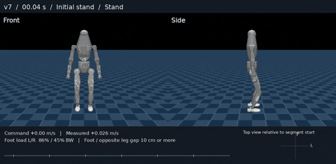
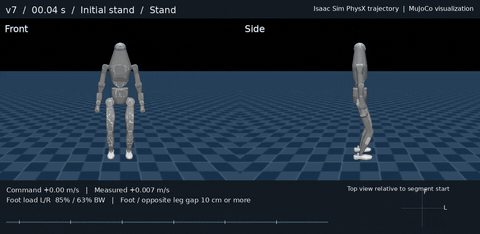

# Dex-WBC-Locomotion-Sim

基于 record12 WBC 的 Dex 站走停与抱箱负载补偿仿真  
支持 MuJoCo 和 Isaac Sim，世界模型用于辅助参考参数标定。

步级世界模型在研发阶段辅助筛选步幅、足部落点等参考参数。运行时使用冻结的 record12 WBC、实时参考规划和腕力补偿完成仿真闭环。详见 [控制架构](docs/ARCHITECTURE.md#世界模型)。

## 克隆后离线安装

在联网机器上克隆本仓库，再把完整项目目录复制到离线机器。源码、共享网格、ONNX 和离线 wheels 包都随 Git 检出。离线机器需有 Linux x86_64、Python 3.11（含 venv）、zstd、tar 和 sha256sum。

在仓库根目录执行。

```bash
(cd packages && sha256sum -c Dex-WBC-Locomotion-Sim-Linux-x86_64-Py311-wheels.tar.zst.sha256)
tar --zstd -xf packages/Dex-WBC-Locomotion-Sim-Linux-x86_64-Py311-wheels.tar.zst
./run_v7.sh verify
./install.sh
```

安装脚本从本目录 `wheels/` 建立 `.venv`，使用 `pip --no-index`。可用 `DEX_V7_BOOTSTRAP_PYTHON` 指定创建虚拟环境的 Python 3.11，或用 `DEX_V7_PYTHON` 指向已安装本包依赖的 Python。

## 运行仿真

| 入口 | 工况和用法 |
| --- | --- |
| MuJoCo | 空手、抱空箱、腕端新增 1 kg / 10 kg。可运行预设路线，或用本机 UDP 和交互窗口发指令。[运行与排查](docs/OPERATION.md) |
| ROS 2 + MuJoCo | 空手遥操作，支持前后、左右横移、原地转向及三轴混合。安装 ROS 2 Humble 后用 `./ros_sim/run.sh build` 构建包内消息。WBC 以 50 Hz 更新目标，ROS 以 100 Hz 下发。[构建与操作](docs/ROS_MUJOCO_TELEOP.md) |
| Isaac Sim | 空手及腕端新增 10 kg，使用独立安装的 Isaac Sim 5.1 和 Isaac Lab 2.3.0。空手也支持 ROS 2 三轴遥操作。[安装与运行](isaacsim/README.md) |

从 MuJoCo 空手路线开始。

```bash
./run_v7.sh live ./out/live
```

抱箱入口为 `empty`、`load-1kg`、`load-10kg-stand`、`load-10kg-forward`、`load-10kg-omni`。每次运行指定一个新的输出目录。双视角渲染可加 `--video`，需 FFmpeg、EGL/OpenGL 和 DejaVu Sans。

## 共享网格与首次运行

MuJoCo 的 MJCF 和 Isaac Sim 的 URDF 共用一套显示网格和一套碰撞网格，位于 `baseline/assets/dex_evt/`。MuJoCo 首次运行自动编译并校验所需的 `.mjb`，也可用 `./run_v7.sh compile` 一次生成四个缓存。Isaac Sim 使用相同网格生成 USD，并使用对应的 MuJoCo 模型计算运动学和箱体参数。Git 忽略两类缓存。

## 箱子重量检测

### 测量对象和仿真条件

MuJoCo 读取腕部六轴传感器，Isaac Sim 使用抓持接口反力。两边均报告两种质量。**箱体总质量**包含 0.650 kg 空箱皮重，**新增质量**等于估计总质量减去 0.650 kg。三个交付物理预设的真实总质量分别为 0.650、1.650 和 10.650 kg。新增配重左右各一半，位于两个腕端抓持点。接重时逐步撤去外部托力。箱体惯量始终参与仿真，腕力反映双手实际承受的载荷。[接重夹具实现](realtime/carry_load_transfer.py)

`run.json` 中的 `model_box_mass_kg` 和 `added_mass_kg` 是物理预设与评测的真值。估重与补偿的运行输入来自腕部传感器和机器人状态。MuJoCo 里双手通过能传递力和力矩的抓持约束承重。

### 从腕部读数到公斤

每侧腕部采集局部坐标下的三轴力 `F` 和三轴力矩 `T`，正向表示机器人施加的支撑。用腕部姿态把二者转到同一个世界坐标系，再减去腕部远端组件的重力支撑量和相对腕点的重力矩。当前模型的远端组件每侧为 0.546466 kg，来自机器人自身模型。设 `R` 为腕到世界的旋转，`G = -m_distal * g_world` 为该组件重量对应的向上支撑，`r_distal` 为腕点指向远端质心的向量，计算如下。

```text
F_box = R · F − G
T_box = R · T − r_distal × G
m_inst = (F_box,left,z + F_box,right,z) / 9.81
```

`m_inst` 是当帧腕力折算的表观总质量。箱体加减速、身体摆动、单手暂时卸载或箱体外部借力时，竖直反力会改变。当前远端补偿扣除静态自重和重力矩，动态惯性残差仍会进入腕部读数。[传感器处理与估重实现](realtime/carry_empty.py)

### 严格窗口与重量分档

每 20 ms 计算一次。严格估重只在站立 `stand` 或行走 `walk` 参考阶段累积数据。要求两侧抓持约束均激活、两侧最大抓持位置误差 **<15 mm**、最大方向误差 **<0.15 rad**，且箱体没有抓持约束之外的穿透接触。阶段改变或条件失效时清空窗口。

静站使用最近 **1.0 秒（50 帧）**，行走使用 **2.0 秒（100 帧）**。按 0.5 秒（25 帧）切段，先求每段左右腕竖直力均值，再把各段合力除以重力加速度。当各段质量的总体标准差 **<0.08 kg**，且整窗内左、右手的平均竖直力分别为正，才输出有效总质量。这里的 0.08 kg 是窗口一致性门槛。有效总质量减去皮重后，与整数 0–10 kg 比较并选最近一档。条件不满足时，当帧质量记为 `NaN`，档位记为 `-1`（未知）。严格路径用于补偿的平滑值仅在有效时更新，更新式为 `held += 0.04 × (max(0, total) − held)`。失效时保留最近一次平滑值。[严格窗口与日志实现](realtime/carry_empty.py)

### 控制器实际用到的负载

- **空箱和新增 1 kg 入口**用严格路径的平滑总质量给双臂做重力前馈。新增 1 kg 的停车落点还使用扣除皮重后的平滑估计，按已标定的前进速度和左右收脚方向调整。[1 kg 负载与收步实现](realtime/carry_payload.py)
- **新增 10 kg 的接重、前进和多方向入口**用快速腕力滤波给双臂补偿。在两个抓持约束均激活、抓持位置误差 **<25 mm**、箱体没有额外穿透接触、腰前倾力矩为有限值、双腕竖直合力为正时，将合力限幅到 **0–160 N**，再以默认 **0.20 秒**时间常数低通。50 Hz 更新权重为 `1 − exp(−0.02/0.20) ≈ 0.0952`。手臂使用上一控制帧的滤波结果，按左右各一半，将竖直支撑力通过抓持点雅可比映射到关节前馈，并保留执行器限幅。快速路径无效时保持上一次滤波状态。持续失效后的降速、放箱或告警仍需另行验证。严格窗口和整数分档在这条路线中用于记录，停车收脚按方向及速度标定。[10 kg 手臂补偿](realtime/carry_load_transfer.py)
- **腰和腿**使用同一对腕部测力和测矩。先把每侧腕点的力矩换算到腰部，即在腕部力矩上加上「腰到腕的力臂 × 腕力」，再取箱体反作用绕机器人左右轴的前倾分量。滤波后生成腰后仰参考和抗前倾前馈，默认参考增益 **0.20°/(N·m)**、后仰上限 **16°**。腿部重心参考后移量按「滤波前倾力矩 ÷（机器人自重＋腕部滤波竖直合力）」计算，默认乘数为 1。后仰程度同时受重量与抱箱力臂影响。[腰腿补偿实现](realtime/wrench_lean.py)

### 真机从电流间接估重

仿真使用 MuJoCo 的腕部六轴读数。真机方案从双臂各轴的**实测转矩分量电流**（如驱动器的 `I_q`）开始，同时采集关节角、速度和机身姿态。用已标定的转矩常数、减速比、传动效率、方向和电流零偏换算关节力矩，再减去手臂自身的重力、惯性和摩擦力矩。用当前姿态下的雅可比转置关系 `τ_load ≈ Jᵀw` 解算手端力和力矩，并统一力与力矩的参考点和坐标系。雅可比条件差、电流饱和、抓持滑移或箱体外部借力时应标记低置信度。双手稳定承重后，再按竖直合力估总质量并扣除真机实测的空箱皮重。该方法需用已称重的载荷、不同抱持姿态和抓持力臂标定。交付数据覆盖仿真名义预设，2–9 kg 逐档、盲测可辨识性、偏载和真机精度仍待验收。[真机接口说明](docs/ARCHITECTURE.md#真机接口验证项)

[估重结果与日志字段](docs/ACCEPTANCE.md#mujoco-腕力估重结果与日志)

## 仿真演示

| 工况 | 演示 |
| --- | --- |
| MuJoCo 空手 | [](docs/videos/Mujoco-front_side.gif) |
| MuJoCo 新增 10 kg 多方向 | [](docs/videos/Mujoco-front_side-withbox.gif) |
| MuJoCo 速度 0–1.2 m/s 档 | [.gif>)](<docs/videos/Mujoco-front_side-speed(0-1.2).gif>) |
| Isaac Sim 空手 | [](docs/videos/IsaacSim-front_side.gif) |
| Isaac Sim 新增 10 kg 抱箱 | [](docs/videos/IsaacSim-front_side-withbox.gif) |

## 验收与交付

已验证工况、可复现记录和当前限制见 [仿真验收](docs/ACCEPTANCE.md)。Isaac Sim 的停车和并步仍有部分工况超限，真机需独立验收。

- [控制架构](docs/ARCHITECTURE.md)
- [真机部署建议](docs/DEPLOYMENT_RECOMMENDATIONS.md)
- [版本说明](docs/RELEASE_NOTES.md)
- [GitHub 仓库交付说明](docs/GITHUB_PACKAGE.md)
