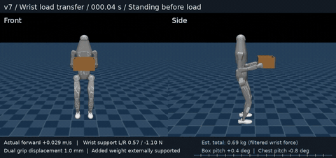

# Dex-WBC-Locomotion-Sim

基于 record12 WBC 的 Dex 站走停与抱箱负载补偿仿真  
支持 MuJoCo 和 Isaac Sim，世界模型用于辅助参考参数标定。

步级世界模型在研发阶段辅助筛选步幅、足部落点等参考参数。运行时使用冻结的 record12 WBC、实时参考规划和腕力补偿完成仿真闭环。详见 [控制架构](docs/ARCHITECTURE.md#世界模型)。

本包提供 MuJoCo 的空手、抱空箱、新增 1 kg、新增 10 kg 四种模型工况，以及 Isaac Sim 的空手与新增 10 kg 两种工况。控制频率 50 Hz。交付环境为 Linux x86_64 和 Python 3.11。

## 仿真演示

以下 GIF 由 `videos/` 中的原始 MP4 转出，统一为 480 px 宽、8 fps 的循环动画；原始 MP4 不随 Git 分发。点击图片可打开对应 GIF。

| 工况 | 演示 |
| --- | --- |
| MuJoCo 空手，75 s | [](docs/videos/Mujoco-front_side.gif) |
| MuJoCo 新增 10 kg 多方向，202 s | [](docs/videos/Mujoco-front_side-withbox.gif) |
| MuJoCo 速度 0–1.2 m/s 档，124 s | [.gif>)](<docs/videos/Mujoco-front_side-speed(0-1.2).gif>) |
| Isaac Sim 空手，75 s | [](docs/videos/IsaacSim-front_side.gif) |
| Isaac Sim 新增 10 kg 抱箱，202 s | [](docs/videos/IsaacSim-front_side-withbox.gif) |

## 克隆后离线安装

在联网机器上克隆本仓库，再把完整项目目录复制到离线机器。源码、共享网格、ONNX 和离线 wheels 包都随 Git 检出。离线机器需有 Linux x86_64、Python 3.11（含 venv）、zstd、tar 和 sha256sum。

在克隆后的仓库根目录执行。

```bash
(cd packages && sha256sum -c Dex-WBC-Locomotion-Sim-Linux-x86_64-Py311-wheels.tar.zst.sha256)
tar --zstd -xf packages/Dex-WBC-Locomotion-Sim-Linux-x86_64-Py311-wheels.tar.zst
./run_v7.sh verify
./install.sh
./run_v7.sh live ./out/live
./run_v7.sh empty ./out/empty
./run_v7.sh load-1kg ./out/load-1kg
./run_v7.sh load-10kg-omni ./out/load-10kg-omni
```

安装脚本从本目录 `wheels/` 建立 `.venv`，使用 `pip --no-index`。已有 Python 环境可设置 `DEX_V7_PYTHON`。双视角渲染可加 `--video`，另需 FFmpeg、EGL/OpenGL 和 DejaVu Sans。

## 共享网格与首次运行

MuJoCo 的 MJCF 和 Isaac Sim 的 URDF 共用 `baseline/assets/dex_evt/` 内的 `meshes_visual/` 与 `meshes_convex/`，两种用途的网格各存一份。MuJoCo 首次运行自动编译所选工况所需的 `.mjb`，与原冻结模型逐个校验 SHA-256 后缓存。也可执行 `./run_v7.sh compile` 一次生成四个，四个缓存合计约 **1.06 GiB**。Isaac Sim 同样会先编译所需的 MuJoCo 模型用于运动学和箱体参数，再从共享网格导入 USD，由 PhysX 推进仿真。生成缓存由 Git 忽略。

Isaac Sim 5.1 和 Isaac Lab 2.3.0 需先单独准备。[Isaac Sim 离线依赖和运行命令](isaacsim/README.md#linux-x86_64-离线安装与运行)

## Isaac Sim 5.1 验证

附带 29 轴 CPU PhysX 接入与 [Isaac Sim 验证说明](isaacsim/README.md)，使用同一套 record12 ONNX。地面碰撞盒保持顶面 z=0，改用 2 m 厚度后，75 秒空手路线最大足底下沉从 9.84 cm 降至 3.67 mm，非足底触地归零。六方向 4 档通过，后退速度与左横移并步脚差仍超限。

双腕新增 10 kg 的 16 档路线在 Isaac Sim 连续运行 202 秒，中途零重置。2 档通过全部单档门槛，主要余项是停车漂移与并步。虚拟双腕反力在静站末秒估得箱体总重 10.652 kg，物理总质量为 10.650 kg。逐档结果与复现命令见 [Isaac Sim 验证说明](isaacsim/README.md)。

## 箱子重量检测

### 测量对象和仿真条件

本节详细公式与验收表来自 MuJoCo。Isaac Sim 用抓持接口反力得到虚拟腕力，详见 [Isaac Sim 验证说明](isaacsim/README.md)。两边均报告两种质量。**箱体总质量**包含 0.650 kg 空箱皮重，**新增质量**等于估计总质量减去 0.650 kg。三个交付物理预设的真实总质量分别为 0.650、1.650 和 10.650 kg。新增配重左右各一半，位于两个腕端抓持点。10 kg 接重试验从第 5.00 秒开始撤掉外部竖直托力，第 5.24 秒完成转移，动力学全程连续。托力尚在时，腕部反映的是当时由双手实际承受的部分。箱体惯量在托力撤除前已经参与仿真。[接重夹具实现](realtime/carry_load_transfer.py)

`run.json` 中的 `model_box_mass_kg` 和 `added_mass_kg` 是物理预设与评测的真值。估重与补偿的运行输入来自腕部传感器和机器人状态。MuJoCo 里双手通过能传递力和力矩的抓持约束承重。

### 从腕部读数到公斤

每侧腕部采集局部坐标下的三轴力 `F` 和三轴力矩 `T`，正向表示机器人施加的支撑。用腕部姿态把二者转到同一个世界坐标系，再减去腕部远端组件的重力支撑量和相对腕点的重力矩。当前模型的远端组件每侧为 0.546466 kg，来自机器人自身模型。设 `R` 为腕到世界的旋转，`G = -m_distal * g_world` 为该组件重量对应的向上支撑，`r_distal` 为腕点指向远端质心的向量，计算如下。

```text
F_box = R · F − G
T_box = R · T − r_distal × G
m_inst = (F_box,left,z + F_box,right,z) / 9.81
```

`m_inst` 是当帧腕力折算的表观总质量。箱体加减速、身体摆动、单手暂时卸载或箱体外部借力时，竖直反力会改变。当前远端补偿扣除静态自重和重力矩，动态惯性残差仍会进入腕部读数。[传感器处理与估重实现](realtime/carry_empty.py)

### 严格窗口与重量分档

每 20 ms 计算一次。严格估重只在站立 `stand` 或行走 `walk` 参考阶段累积数据。要求两侧抓持约束均激活、两侧最大抓持位置误差 **<15 mm**、最大方向误差 **<0.15 rad**，且箱体没有抓持约束之外的穿透接触。阶段改变或条件失效时清空窗口。

静站使用最近 **1.0 秒（50 帧）**，行走使用 **2.0 秒（100 帧）**。按 0.5 秒（25 帧）切段，先求每段左右腕竖直力均值，再把各段合力除以重力加速度。当各段质量的总体标准差 **<0.08 kg**，且整窗内左、右手的平均竖直力分别为正，才输出有效总质量。这里的 0.08 kg 是窗口一致性门槛。有效总质量减去皮重后，与整数 0–10 kg 比较并选最近一档。条件不满足时，当帧质量记为 `NaN`，档位记为 `-1`（未知）。严格路径用于补偿的平滑值仅在有效时更新，更新式为 `held += 0.04 × (max(0, total) − held)`。失效时保留最近一次平滑值。[严格窗口与日志实现](realtime/carry_empty.py)

### 控制器实际用到的负载

- **空箱和新增 1 kg 入口**用严格路径的平滑总质量给双臂做重力前馈。新增 1 kg 的停车落点还使用扣除皮重后的平滑估计，按已标定的前进速度和左右收脚方向调整。[1 kg 负载与收步实现](realtime/carry_payload.py)
- **新增 10 kg 的接重、前进和多方向入口**用快速腕力滤波给双臂补偿。在两个抓持约束均激活、抓持位置误差 **<25 mm**、箱体没有额外穿透接触、腰前倾力矩为有限值、双腕竖直合力为正时，将合力限幅到 **0–160 N**，再以默认 **0.20 秒**时间常数低通。50 Hz 更新权重为 `1 − exp(−0.02/0.20) ≈ 0.0952`。手臂使用上一控制帧的滤波结果，按左右各一半，将竖直支撑力通过抓持点雅可比映射到关节前馈，并保留执行器限幅。快速路径无效时保持上一次滤波状态。持续失效后的降速、放箱或告警仍需另行验证。严格窗口和整数分档在这条路线中用于记录，停车收脚按方向及速度标定。[10 kg 手臂补偿](realtime/carry_load_transfer.py)
- **腰和腿**使用同一对腕部测力和测矩。先把每侧腕点的力矩换算到腰部，即在腕部力矩上加上「腰到腕的力臂 × 腕力」，再取箱体反作用绕机器人左右轴的前倾分量。滤波后生成腰后仰参考和抗前倾前馈，默认参考增益 **0.20°/(N·m)**、后仰上限 **16°**。腿部重心参考后移量按「滤波前倾力矩 ÷（机器人自重＋腕部滤波竖直合力）」计算，默认乘数为 1。后仰程度同时受重量与抱箱力臂影响。[腰腿补偿实现](realtime/wrench_lean.py)

### 实测结果和读日志的方法

下表按单档稳态窗口统计。窗口从各档指令开始后 2.5 秒到回零前。严格估重范围取**各档有效帧均值**的最小与最大值；有效率的分母为该档稳态窗口全部帧。这组数值描述已测物理预设的表现。

| 工况 | 物理总质量 kg | 严格估重的各档均值 kg | 严格窗口有效率 |
| --- | ---: | ---: | ---: |
| 空箱 19 档 | 0.650 | 0.648–0.651 | 59.6%–89.3% |
| 新增 1 kg 前进四档 | 1.650 | 1.648–1.650 | 41.8%–80.0% |
| 新增 10 kg 前进四档 | 10.650 | 10.624–10.651 | 40.4%–56.4% |
| 新增 10 kg 左右横移六档 | 10.650 | 10.623–10.641 | 10.7%–52.4% |
| 新增 10 kg 左右转向六档 | 10.650 | 10.638–10.651 | 50.7%–86.7% |

10 kg 多方向路线中，快速通道的各档稳态总质量均值为 **10.630–10.675 kg**。严格窗口最少的是左横移 0.30 m/s，只有 **10.7%** 的帧有效。逐窗有效性与有效样本的估重偏差应分别看。[空箱](examples/empty/metrics.json) · [新增 1 kg](examples/load-1kg/metrics.json) · [新增 10 kg 逐档数据](examples/load-10kg-omni/metrics.json)

60 秒静站复算中，第 **6.08 秒**首次输出新增 10 kg 的有效档位；第 **6.22 秒**快速通道首次进入总质量 10.65 kg 的 ±0.10 kg 范围。身体收稳的时间为第 **6.54 秒**，即完全承重后 **1.30 秒**，按独立的姿态、位移和腕力波动门槛判定。[60 秒静站结果](examples/load-10kg-stand/settle_metrics.json)

复算用运行包或重新运行生成的 `rollout.npz`。按 `physics_time` 对齐以下字段。

| 字段 | 含义 |
| --- | --- |
| `wrist_local`、`wrist_compensated_world` | 每帧左右腕的局部原始读数和世界系去自重后的读数，单位 N、N·m |
| `estimates` | 四列依次为瞬时表观总质量、严格窗口总质量、严格有效标记、严格路径保持的平滑总质量 |
| `estimated_added_mass_kg`、`estimated_mass_bin` | 严格有效样本扣除皮重后的新增量和整数档位；早期空箱归档省略这两个字段 |
| `balance_trace` | 10 kg 快速路径的完整字段顺序见对应 `run.json` 的 `balance_fields`。`filtered_support_force_n` 除以 9.81 得到下一控制帧手臂补偿所用的质量尺度，`wrench_valid` 是快速通道更新标记 |
| `load_compensation_joint_delta_rad` | 箱体支撑项实际改变的双臂关节目标，单位 rad |

### 真机从电流间接估重

仿真使用 MuJoCo 的腕部六轴读数。真机方案从双臂各轴的**实测转矩分量电流**（如驱动器的 `I_q`）开始，同时采集关节角、速度和机身姿态。用已标定的转矩常数、减速比、传动效率、方向和电流零偏换算关节力矩，再减去手臂自身的重力、惯性和摩擦力矩。用当前姿态下的雅可比转置关系 `τ_load ≈ Jᵀw` 解算手端力和力矩，并统一力与力矩的参考点和坐标系。雅可比条件差、电流饱和、抓持滑移或箱体外部借力时应标记低置信度。双手稳定承重后，再按竖直合力估总质量并扣除真机实测的空箱皮重。该方法需用已称重的载荷、不同抱持姿态和抓持力臂标定。交付数据覆盖仿真名义预设，2–9 kg 逐档、盲测可辨识性、偏载和真机精度仍待验收。[真机接口说明](docs/ARCHITECTURE.md#真机接口验证项)

## 验收范围

示例 `run.json` 的 `options.profile` 保留历史标定来源，`carry_profile` 保存实际生效的参数。交付入口的默认标定已与空箱、1 kg 前进、10 kg 前进和 10 kg 多方向四条示例的生效参数逐项核对一致。

六个入口在独立 Python 环境中安装并实跑通过。新增 10 kg 的多方向工况在一条 202 秒仿真中完成前进、左右横移及左右转向共 16 档，全程零重置。转向中心平移、横移串轴和 0.40 m/s 微扰初态下的停车补步仍有待改善。真机需独立验收。

- [运行与排查](docs/OPERATION.md)
- [验收结果与已知限制](docs/ACCEPTANCE.md)
- [控制架构与真机接口](docs/ARCHITECTURE.md)
- [真机部署建议与分阶段验收](docs/DEPLOYMENT_RECOMMENDATIONS.md)
- [交付复验记录](verification/delivery_validation.json)
- [版本说明](docs/RELEASE_NOTES.md)
- [GitHub 仓库交付说明](docs/GITHUB_PACKAGE.md)
